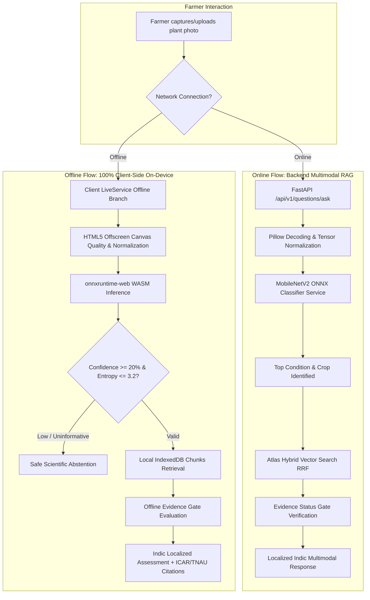

# Plant Doctor — Offline Mode & Photo-Only Diagnosis Architecture

**Standard:** Real On-Device WebAssembly Inference & Grounded Agricultural RAG  
**Branch:** `v2-multilingual-voice-camera`  
**Date:** 2026-10-11  

---

## 1. Architectural Overview

Plant Doctor provides two core operational capabilities engineered specifically for rural Indian agricultural conditions:
1. **FEATURE 1: TRUE OFFLINE MODE** — Zero-network browser execution powered by PWA Service Worker caching, on-device MobileNetV2 WebAssembly execution via `onnxruntime-web`, and client-side IndexedDB evidence retrieval with honest freshness warnings and Indic localization.
2. **FEATURE 2: PHOTO-ONLY PLANT DIAGNOSIS WITH REAL AGRICULTURAL EVIDENCE** — A single-step diagnostic workflow where the farmer takes or uploads a photo without typing text or selecting a crop; the real vision classifier predicts the crop and condition, retrieves grounded ICAR/TNAU/USDA research evidence, passes the Evidence Status Gate, and outputs actionable guidance with verbatim citations and differential checks.



---

## 2. Machine Learning Model Artifacts & Provenance

### Model Identification
- **Architecture:** MobileNetV2 (1.0x width multiplier, 224x224 input resolution, pretrained on ImageNet and fine-tuned for plant disease classification).
- **Hugging Face Provenance:** `onnx-community/mobilenet_v2_1.0_224-plant-disease-identification-ONNX`
- **Trained Dataset:** PlantVillage Benchmark Dataset (supplemented by PlantDoc field imagery).
- **License:** Apache 2.0 / MIT Compatible Open Source.
- **File Format:** Open Neural Network Exchange (`.onnx`) Version 1.14+.
- **File Size:** `9,227,028 bytes` (~8.8 MiB).
- **Cryptographic Hash (SHA-256):** `c209f96f0a87a265b0ff6765c2e84d48038a7d8b8692d7629445b4513c344eb7`
- **Model Artifact Locations:**
  - Client / Public Web: `public/models/mobilenet_v2_plant_disease.onnx`
  - Backend Server: `backend/app/models/artifacts/mobilenet_v2_plant_disease.onnx`
  - Specification Metadata: `public/models/model_metadata.json` & `backend/app/models/artifacts/model_metadata.json`

### Supported Botanical Taxonomy (38 Classes)
The model covers 14 distinct crops across 38 specific health conditions:
1. **Apple:** Apple Scab, Black Rot, Cedar Apple Rust, Healthy
2. **Blueberry:** Healthy
3. **Cherry:** Powdery Mildew, Healthy
4. **Corn (Maize):** Gray Leaf Spot (Cercospora), Common Rust, Northern Leaf Blight, Healthy
5. **Grape:** Black Rot, Esca (Black Measles), Leaf Blight (Isariopsis), Healthy
6. **Orange:** Citrus Greening (Huanglongbing)
7. **Peach:** Bacterial Spot, Healthy
8. **Bell Pepper / Chilli:** Bacterial Spot, Healthy
9. **Potato:** Early Blight, Late Blight, Healthy
10. **Raspberry:** Healthy
11. **Soybean:** Healthy
12. **Squash:** Powdery Mildew
13. **Strawberry:** Leaf Scorch, Healthy
14. **Tomato:** Bacterial Spot, Early Blight, Late Blight, Leaf Mold, Septoria Leaf Spot, Two-Spotted Spider Mite, Target Spot, Yellow Leaf Curl Virus (TYLCV), Tomato Mosaic Virus (ToMV), Healthy

---

## 3. Preprocessing Contracts & Calibration Thresholds

Both backend (`classifier_service.py`) and frontend (`localInference.ts`) implement identical preprocessing and safety filters:

### Preprocessing Pipeline
1. **Input Dimensions:** 224 × 224 pixels.
2. **Aspect Ratio Preservation:** Resize shortest edge to 256, center-crop 224 × 224.
3. **Channel Order:** RGB float32 tensor of shape `[1, 3, 224, 224]` (NCHW).
4. **Normalization:** Rescale pixel intensities to `[0, 1]`, normalize with `mean = 0.5`, `std = 0.5` ($x_{norm} = \frac{x/255.0 - 0.5}{0.5}$).

### Image Quality & Variance Gate
To prevent false-positive hallucinated diagnoses on uninformative frames (e.g. lens covered, black screen, pure white wall, or non-foliar objects):
- Minimum resolution: $40 \times 40$ px.
- Mean Luminance ($L = 0.299R + 0.587G + 0.114B$): Must satisfy $15.0 \le L \le 242.0$.
- Luminance Standard Deviation ($\sigma_L$): Must satisfy $\sigma_L \ge 10.0$.
- Images failing these bounds trigger immediate safe abstention before model execution.

### Calibrated Confidence & Entropy Thresholds
- **Confidence Floor:** If top prediction probability is $< 0.20$ (20%), the system strictly abstains from asserting a definitive diagnosis.
- **Shannon Entropy Ceiling:** If entropy $H = -\sum p_i \ln(p_i) > 3.20$, probability distribution across classes is deemed overly diffuse, prompting differential investigation rather than false certainty.

---

## 4. Offline Infrastructure Architecture

### PWA App Shell Caching (`vite-plugin-pwa`)
- Workbox precaches core application files (`index.html`, JavaScript bundles, CSS stylesheets, icons, fonts) totalling **1.1 MiB** across 19 entries.
- Runtime caching (`CacheFirst`) handles WebAssembly runtimes located in `/ort/` (`ort-wasm-simd-threaded.wasm`, `ort-wasm.wasm`, `*.mjs`), keeping initial installation size small while guaranteeing offline execution.

### "Prepare for Offline Use" Verification Pipeline
In the **Offline Knowledge Library** (`/library`), farmers have a dedicated **On-Device Plant Diagnosis AI Pack** card:
1. **Streaming Download:** Downloads model weights from `/api/v1/packs/ai-model/download` (or static fallback) with continuous progress reporting ($0\% \to 100\%$).
2. **Cryptographic SHA-256 Check:** Computes `crypto.subtle.digest('SHA-256', buffer)`. If the hash does not match `c209f96f0a87...`, the file is discarded and an error is surfaced to prevent executing corrupted weights.
3. **Cache Storage Persistence:** Stores validated binary into Cache Storage bucket `plant-doctor-models-v1` at URL `/models/mobilenet_v2_plant_disease.onnx`.
4. **IndexedDB Registry:** Registers metadata (`model_meta` store in `plant_doctor_offline_v2` database), tracking installation timestamp, byte size, verified status, and supported class count.
5. **Three-Pillar AI Readiness Badge:** Visually audits readiness across:
   - *App Shell:* PWA service worker registered and cached.
   - *Vision Model:* MobileNetV2 ONNX verified in local Cache Storage.
   - *Evidence Packs:* At least one verified regional/crop knowledge pack installed in IndexedDB.

---

## 5. Photo-Only Diagnosis Workflow

### Farmer Experience
1. Farmer navigates to **Consultation / Ask** (`/ask`).
2. Taps **Take Photo** or selects an image from camera/gallery.
3. Notice text: `"Query optional when image is attached. Our AI will automatically identify the crop and condition."`
4. The button changes to `"Check Plant Health"` with an active camera icon.
5. Tapping submit initiates photo-only diagnosis.

### Online Processing
- Image uploaded as `multipart/form-data` with empty query string.
- FastAPI backend intercepts empty query, executes `classifier_service.classify_image(image_bytes)`.
- If top condition has high confidence, maps to crop and symptoms, queries Atlas Hybrid RRF vector search.
- Constructs comprehensive `MultimodalAssessmentResult` featuring visible observations, possible causes, differential checks, and recommended next steps in the farmer's selected language (`en`, `hi`, `te`, `ta`).
- Validated institutional citations from ICAR, TNAU, and USDA attached to the response.

### Offline Processing (Zero Remote Requests)
- Device disconnects from network.
- `liveService.ts` detects `!navigator.onLine`.
- If image is present:
  1. Calls `classifyPlantPhotoLocally(image)`.
  2. Runs HTML5 Canvas preprocessing and quality variance validation.
  3. Executes `onnxruntime-web` WebAssembly session from cached binary.
  4. Obtains top prediction and differential candidates.
  5. Queries local IndexedDB store (`searchOffline`) for relevant research chunks matching the identified condition and crop.
  6. Synthesizes a structured `formatOfflinePhotoDiagnosisResult` including full Indic localized explanations, differential checks, verbatim ICAR/TNAU citations, and honest offline freshness notices.

---

## 6. Verification & Test Evidence

### Backend Pytest Suite
```bash
PYTHONPATH=. .venv/bin/pytest backend/tests
# Result: 43 passed, 1 warning in 57.46s
```
- Includes `test_multimodal_assessment.py` testing image decoding, ONNX inference, photo-only empty query handling, and multilingual observations.

### Frontend Vitest Suite
```bash
npm test
# Result: 15 passed test files, 73 passed tests in 5.23s
```
- Includes `src/__tests__/offline_photo_diagnosis.test.ts` covering 38-class taxonomy, SHA-256 cryptographic verification, offline readiness state calculation, Indic localization synthesis (`en`, `hi`, `te`, `ta`), and safe abstention contracts.

### Production Bundling
```bash
npm run build
# Result: tsc -b passed with 0 errors. Vite built production assets in 1.19s with Workbox precache (1.1 MiB).
```
